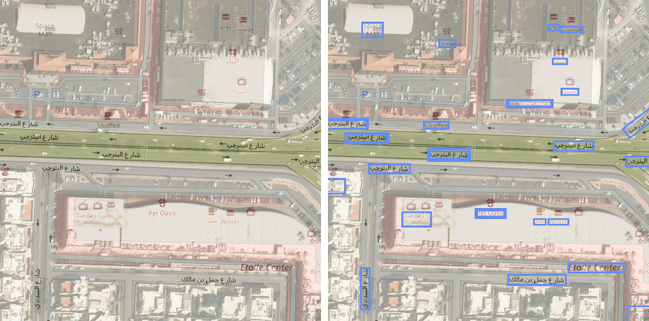
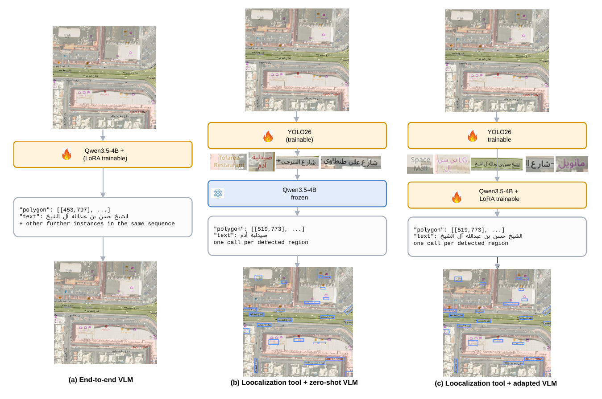

<div align="center">


### Tool-Augmented Vision–Language Models for Arabic Geospatial Text Spotting

Yakoub Bazi, Sarah Alsaleh, Mohamad M. Al Rahhal, Mohamed A. Mekhtiche, Mansour Zuair

King Saud University, Riyadh, Saudi Arabia

</div>



**ArabGeoText** detects and reads Arabic place names on map tiles and satellite imagery.
The benchmark covers 970 locations in Riyadh and Jeddah with 17,875 annotated text
instances, in paired OpenStreetMap and map–imagery views.

## 🧩 Approach

A vision–language model reads a cropped word well, but placing polygons for every label in
a 1024×1024 tile is a different problem. We therefore separate the two: a detector finds the
text regions, and the model reads them.



## 🚧 Release status

| Item | Status |
|---|---|
| Inference code | Coming soon |
| Evaluation code | Coming soon |
| Pre-trained models | Coming soon |
| Training code | Coming soon |
| Dataset | Coming soon |

## 📄 Citation

```bibtex
@article{arabgeotext2026,
  title  = {ArabGeoText: Tool-Augmented Vision--Language Models for Arabic
            Geospatial Text Spotting},
  author = {Bazi, Yakoub and Alsaleh, Sarah and Al Rahhal, Mohamad M. and
            Mekhtiche, Mohamed A. and Zuair, Mansour},
  year   = {2026}
}
```

## 📬 Contact

Yakoub Bazi — ybazi@ksu.edu.sa

## ⚖️ License

See [LICENSE](LICENSE). Map data © OpenStreetMap contributors (ODbL).
