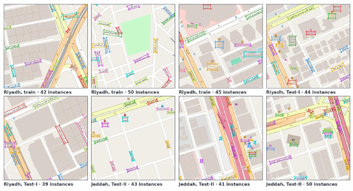
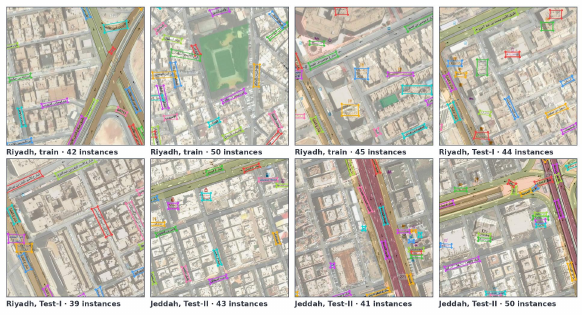
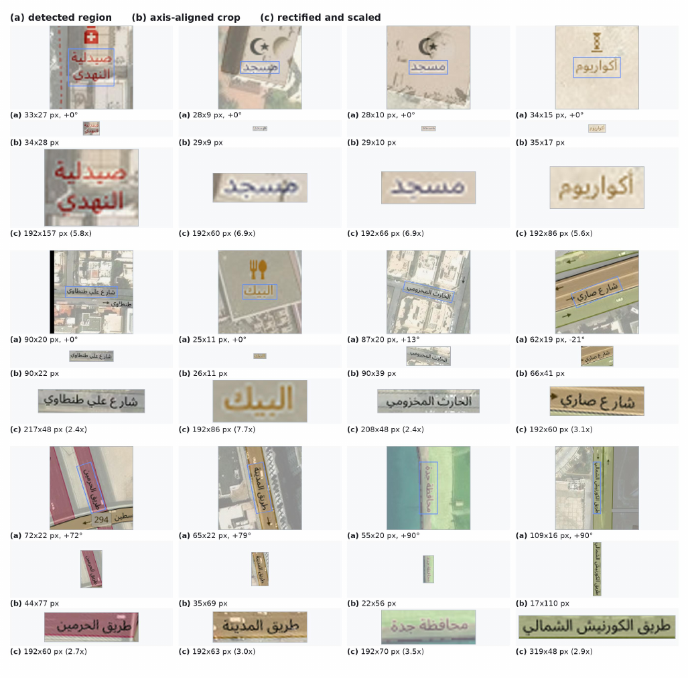
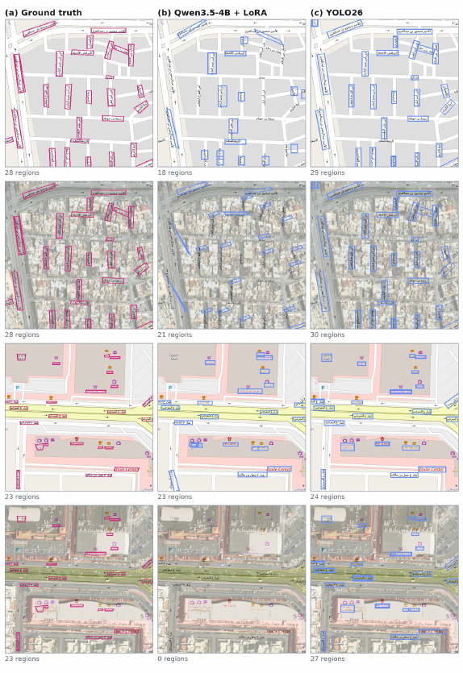

<div align="center">


### Tool-Augmented Vision–Language Models for Arabic Geospatial Text Spotting

Yakoub Bazi, Sarah Alsaleh, Mohamad M. Al Rahhal, Mohamed A. Mekhtiche, Mansour Zuair

King Saud University, Riyadh, Saudi Arabia

</div>

---

## Overview

ArabGeoText is a benchmark and a set of models for Arabic geospatial text spotting:
detecting and transcribing the place names rendered on OpenStreetMap tiles and on
map–imagery composites. The benchmark covers 970 locations in Riyadh and Jeddah with
17,875 annotated text instances per view.

## Dataset

Each location is provided in two paired views carrying identical labels at identical
positions: an OpenStreetMap rendering, and the same rendering composited over satellite
imagery. Tiles are 1024×1024 at Web Mercator zoom 18 (about 0.55 m/pixel).

<p align="center">
  <br/>
  
</p>
<p align="center"><sub>Annotated examples: OSM view (top) and RS+OSM view (bottom).</sub></p>

## Method

We compare direct spotting, where a single vision–language model generates polygons and
transcriptions from the whole tile, against a tool-augmented pipeline in which a detector
supplies text regions and the VLM reads them.

<p align="center">
  
</p>
<p align="center"><sub>(a) direct VLM spotting &nbsp;·&nbsp; (b) detector with a frozen
reader &nbsp;·&nbsp; (c) detector with an adapted reader.</sub></p>

Each detected region is reduced to an oriented quadrilateral, rectified, and enlarged
before recognition.

<p align="center">
  
</p>
<p align="center"><sub>(a) detected region &nbsp;·&nbsp; (b) axis-aligned crop
&nbsp;·&nbsp; (c) rectified and scaled crop given to the reader.</sub></p>

## Results

<p align="center">
  
</p>
<p align="center"><sub>Reference annotations in magenta, predictions in blue.</sub></p>

## Release status

| Item | Status |
|---|---|
| Inference code | Coming soon |
| Evaluation code | Coming soon |
| Pre-trained models | Coming soon |
| Training code | Coming soon |
| Dataset | Coming soon |

## Citation

```bibtex
@article{arabgeotext2026,
  title  = {ArabGeoText: Tool-Augmented Vision--Language Models for Arabic
            Geospatial Text Spotting},
  author = {Bazi, Yakoub and Alsaleh, Sarah and Al Rahhal, Mohamad M. and
            Mekhtiche, Mohamed A. and Zuair, Mansour},
  year   = {2026}
}
```

## Contact

Yakoub Bazi — ybazi@ksu.edu.sa

## License

Code is released under the Apache 2.0 License.
Map data © OpenStreetMap contributors (ODbL).
